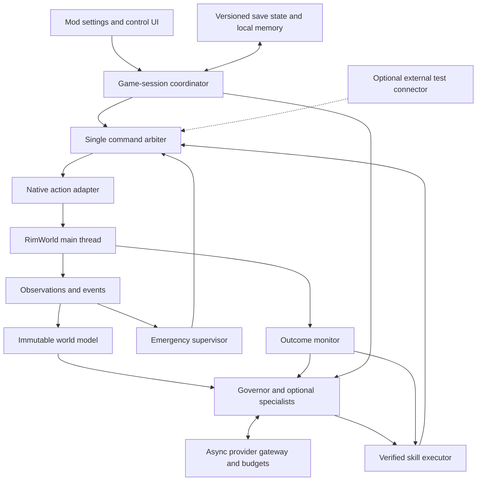

# Survival core architecture

**Decision:** ship a self-contained RimWorld mod with an embedded C# control runtime and asynchronous, provider-neutral LLM access. A player installs the mod, selects a supported provider, enters a key, and enables autonomous survival. No Python environment, MCP server, Codex session, external daemon, or companion desktop app is required for normal play.

The first product goal is **reliable vanilla colony survival**. DLC mechanics and victory support follow only after survival passes its release gate. This document decides the architecture and interactions; it does not claim the implementation or live validation is complete. The supporting [open-source research](../research/2026-09-09-autonomous-player-core-design.md) distinguishes source evidence from unverified project claims.

## Product boundary

Target a pinned, tested RimWorld 1.6 build with Core and the mod's declared dependencies. The initial reference scenario is a normal three-colonist Crashlanded start on one home map, initially in temperate conditions. Expand the survival suite across seasons and selected biomes before general release. An existing colony can be enabled only when its active content and required capabilities pass compatibility checks.

Publish the existing Agent project as the **player-facing Workshop mod**, with **RimAI Framework and Harmony as its only declared runtime mod dependencies**. Steam dependencies provide the normal installation path; the player configures everything through the player mod's settings. Framework owns its existing assembly identities; the player mod references them and never bundles second copies. A manual release contains the player and Framework mod folders with clear Harmony dependency instructions. Verify dependency resolution and assembly loading in a clean installation; installation must not require a build or a command line.

Ship the player and required Framework changes as a paired, tested release. Define a versioned player/provider contract with required capabilities for immutable request configuration, cancellation, bounded structured responses and usage reporting. At startup validate the actual Framework contract/capabilities and supported version range, not just package presence. An incompatible Framework disables autonomy and names the required compatible release; ordinary manual gameplay remains available. Pin the tested dependency combination in the release manifest and test upgrades and older installed dependencies.

The release promise applies to a published supported-provider/model matrix and supported game configurations. A syntactically valid API key cannot make an incompatible or weak model reliable. Advanced custom endpoints are an opt-in compatibility mode, outside the initial “just works” guarantee.

Initial autonomy covers food, shelter, temperature, rest and recreation, sanitation, medical care, work, production, modest infrastructure/research, fire, raids, wildlife threats, and recovery from resource/job bottlenecks. Ordinary base-game crafting, hunting, growing, hauling, construction, repairs and combat are within scope. World travel, multi-colony management, victory sequences, DLC systems, and arbitrary third-party gameplay mods are later capabilities. Ordinary visiting-trader interaction can be added after baseline self-sufficient survival; the initial controller must not depend on trading to remain viable.

## Design principles

1. **Native gameplay determines outcomes.** Issue player-equivalent orders; let RimWorld perform travel, labor, resource consumption, combat, and treatment. No teleportation, forced research completion, spawning, or hidden-state knowledge in the survival profile.
2. **Main-thread game access, pure decision logic.** Read/write Verse objects only on the main thread. Background workers receive immutable DTOs and return typed proposals. They never hold live game object references.
3. **One authority for gameplay writes.** The arbiter owns action and simulation-control decisions. Specialists, the model, optional external tools, and scripted skills cannot bypass it.
4. **Model calls are bounded advice.** The local executor and emergency supervisor remain operational without a model response. A model error must not crash the game, apply malformed actions, or let an unattended colony run indefinitely.
5. **Observe the outcome.** Accepted orders are not completed work. Every skill has measurable completion, failure, timeout, and cancellation conditions.
6. **Do not disguise missing information.** Unknown, stale, omitted and unavailable differ from zero, safe and empty. Maintain complete queryable state, with bounded prompts derived from it.
7. **Reuse before replacing.** Preserve useful Framework/perception code; adapt audited MIT native-action implementations; use existing bridges and benchmarks for development. Keep third-party provenance and version boundaries explicit.
8. **Simple release, extensible internals.** Multiple logical modules do not imply multiple installations or processes. A single governor is the baseline; specialists and vector retrieval must earn their runtime cost through evaluation.

## Required parts and ownership

These are logical modules in the shipped C# code, not separate services. Keep the pure domain code compatible with RimWorld's supported Unity/Mono target. The existing .NET Framework target is the starting point, subject to a real-game compatibility build.

| Part | Owns | Inputs and outputs | Thread/lifetime |
|---|---|---|---|
| **Mod entry and settings UI** | Dependency/config validation, provider selection, autonomy toggle, status, takeover | Settings → validated session configuration; runtime → visible status | Main thread; application settings |
| **Game-session coordinator** | Session state machine, cancellation, deadlines, update order, save generation | Game lifecycle + module results → scheduled work | Main thread; one loaded game |
| **Observation adapter** | Native reads, entity identity, visibility filtering, capability inventory | Game → immutable snapshot/deltas with completeness metadata | Main thread; map/session scoped |
| **Event collector** | Activated Harmony hooks plus polling backstop | Game incidents/changes → ordered event records | Main thread; bounded queue |
| **World model** | Latest snapshot, spatial graph, dependency/resource calculations | Snapshots/events → query results and bounded summaries | Immutable generation published to pure workers |
| **Emergency supervisor** | Urgent detection, stop/pause policy and tested reflex proposals | Events + fresh essential state → interrupt proposal | Main thread for detection; no LLM dependency |
| **Colony governor** | Objectives, survival priorities, plan selection and escalation | World summary, skill state, results, budget → plan proposals | Pure C#; bounded background work |
| **Optional specialists** | Focused medical, defense, layout or production advice | Explicit governor subproblem → ranked proposals | Pure/async; no direct game writes |
| **Skill library and executor** | Bundled verified workflows, preconditions, progress, cancellation | Chosen plan + state/results → typed command proposals | Pure decision state; advanced by coordinator |
| **Command arbiter** | Validation, priorities, ownership, reservations, deduplication | Proposals → ordered admitted/rejected commands | Main-thread admission and execution checks |
| **Native action adapter** | Resolving current IDs and issuing normal game orders | Admitted commands → immediate receipts | Main thread; never restores stale object references |
| **Outcome monitor** | Progress/postconditions and causal reconciliation | Receipts + later state/events → status/results | Main-thread observations; pure predicate evaluation |
| **Provider gateway and budget manager** | Async HTTP, model capabilities, request parsing, accounting, retries/circuit breaker | DTO prompt/schema → validated proposal or typed error | Async worker; no game access |
| **Save state, memory and bounded diagnostics** | Objectives, skill versions, recent outcomes, settings references, run evidence | Domain state/events → versioned save payload and rotating local logs | Main-thread capture/load; background I/O from copies |
| **Optional test connector** | GABS/RimBridge SDK and evaluator access | Test tools → same observation/arbiter interfaces | Development-only package/profile |

The normal player build exposes no network listener. API calls are outbound only to the configured provider. External agents can operate a development build through a connector without becoming a production dependency. Default to one outstanding model decision per colony; logical specialist modules do not each require a paid request. Capture provider settings on the main thread into immutable configuration snapshots before starting async work.

## Core contracts

**Observation envelope:** schema version, run ID, save generation, map ID, simulation tick, monotonic observation sequence, observation profile, completeness/truncation flags, changed sections and event cursor. Stable IDs identify entities within a generation; map coordinates include map identity. Full observations establish a baseline; deltas name that baseline. Missing/out-of-order deltas trigger a fresh snapshot.

**State queries:** full accessible pawn, building, job, bill, zone, policy and resource indexes, with paginated/detail queries. Model summaries never permanently discard the ninth colonist or sixth hostile. Include terrain, rooms, roofs, temperature, cover, passability, growing conditions and access routes. Record unavailable values explicitly. The standard profile removes fog-hidden entities and privileged storyteller values at the shared observation boundary, before every autonomous consumer, including deterministic skills and emergency supervision. Privileged evaluation reads use a separate interface. Cached sections carry their own observation ticks; incremental reads must not falsely claim to be an atomic same-tick snapshot.

**Plan/skill proposal:** objective, source observation, prerequisites, selected skill/version, parameters, resource budget, priority, expected progress, deadline and cancellation conditions. A proposal contains only registered skill/command identifiers. The runtime does not compile arbitrary generated code. Learned variants remain untrusted candidates until tested and promoted outside a live scored colony.

**Command envelope:** command ID, session/save generation, source observation/tick, target map/entity IDs, typed parameters, priority, deadline, preconditions, ownership/reservation scope, and expected effect. Core parameter types use validated DTOs, not free-form dictionaries passed into game APIs. Advertise supported commands and schema versions; unsupported commands fail explicitly.

**Command result:** `accepted → started → completed`, or `rejected`, `failed`, `cancelled`, `expired`, `interrupted`, or `unknown_outcome`, with reason, evidence tick and affected IDs. The exact lifecycle depends on the command: blueprint placement completes when a legal blueprint exists; building construction is a skill monitored separately. An order receipt includes its postcondition and observation needed for verification.

Completion predicates come from registered, tested command/skill implementations. Model-proposed descriptions of success cannot replace those predicates or mark their own actions verified.

**Events:** ordered within a generation, bounded and acknowledged by cursor. Critical events have reserved capacity. Overflow is visible and forces a complete essential-state refresh plus conservative pause; it cannot silently hide a raid. Snapshots/polling reconcile missed hooks and external human changes.

## Survival capability set

The implementation must discover Defs and actual game availability rather than assuming every recipe/building/research project exists. Register only capabilities implemented and tested for the current build/profile.

| Domain | Required observations | Required ordinary actions and skills | Evidence of success |
|---|---|---|---|
| **Food** | Edible nutrition, spoilage, reachable supplies, crop timing, pawn restrictions, work capacity | Unforbid, haul, grow/harvest, hunt when appropriate, butcher/cook bills, storage/filter policies | Meals/nutrition produced and consumed; positive food trajectory and reserves |
| **Shelter and temperature** | Weather, room enclosure/roof, temperatures, fuel/power, beds, materials, access | Place/cancel blueprints, designate mining/woodcutting, construct/repair, refuel, power switches, bed assignment | Habitable reachable shelter, operational heat/cooling and sufficient rest |
| **Work and production** | Skills, priorities, schedules, current jobs, blocked reasons, stations, ingredients, bills | Work/schedule/policy updates, stockpile/growing zones, bill CRUD, legal job prioritization | Actual work progresses; ingredients consumed and products appear; bottlenecks resolve |
| **Health and mood** | Wounds, bleeding, disease/immunity, pain, medicine, beds, needs, relevant thoughts | Rescue, tend, bed rest, medical policies, cleaning, rest/recreation schedule; safe routine care | Treatment and recovery observed; urgent deterioration addressed; needs remain viable |
| **Defense and fire** | Visible threats, pawn readiness, weapons, cover, paths, fire extent and exits | Draft/undraft, ordered movement/attack, equip, retreat, firefighting, safe-area policies | Threat handled or escaped; normal pathing/combat occurs; fire contained and pawns released to work |
| **Infrastructure and research** | Dependencies, research prerequisites, production/material needs, current capacity | Legal project selection, build supporting facilities, sustain inputs | Work-based research and useful capacity increase without undermining survival |

Default policy favors immediate life preservation, then food/temperature stability, then sustainable work and gradual improvement. Avoid wealth or research maximization as the survival objective. Specialist conflict resolution respects active emergency reservations: a doctor treating a critical patient cannot be reassigned casually to hauling or defense.

## Required interactions

The coordinator state machine is `Disabled → Configuring → ReadyPaused → Active`. `Active` has `Observing`, `Planning`, `Executing` and `Verifying` phases; validated existing skill steps may proceed while a nonconflicting advisory request is pending. An interrupt enters `EmergencyPaused`; a recoverable provider/capability/budget problem enters `BlockedPaused`. The human Stop control enters `Disabled` after revoking ownership. Save load/menu transition enters `Reinitializing`, increments generation and cancels all old work before returning to `ReadyPaused`. Only the coordinator changes these states. Every paused state records its owner, reason, entry time and required recovery; an active simulation window has a deadline and always returns to observation.

### Installation and first enable

1. Load without networking or starting autonomy. Validate dependencies and supported game/mod profile; display a concrete compatibility error if required capabilities are absent.
2. In settings, select a supported provider preset, enter the key, and use the preset's tested model default. Custom URL/model controls are advanced. Explain that requests send colony context and incur the provider's normal charges.
3. On explicit connection test/enable, send a small bounded request that checks authentication and the expected response contract. Distinguish invalid key, unavailable model, quota/rate limit, network failure and invalid structured output. Do not start playing on a failed test.
4. Enable on the loaded colony. Take a full snapshot, validate required observations/actions, initialize objectives and establish exclusive control. Start in supervised pause-before-decision mode, then use bounded play windows when stable. Show current objective, last verified action and active budget.

A run must have request/token ceilings and a time limit for in-flight calls. Use a cost ceiling only when provider usage/pricing is available and trustworthy; otherwise show cost as unavailable and enforce request/token ceilings. Release defaults are versioned and calibrated with the supported model suite. They must never mean unlimited spending. The user can adjust caps before enabling.

Before dispatch, durably reserve one request and a conservative input/output allowance in a small local expenditure ledger independent of rewindable game saves. Account for connection tests, repair attempts and retries. Reconcile against reported usage afterward; a timeout or missing usage leaves the uncertain allowance consumed instead of refunding it. Reject a request that would exceed a ceiling. Persist run/provider-profile spending and configured period boundaries across restarts; loading an older save cannot reset spending. Budget resets require an explicit user action or the declared period rollover. The ledger contains no key or prompt content; cap accounting must fail closed if it cannot be persisted. This is a client-side spending bound, not a substitute for provider-account billing controls.

### Routine decision and execution

The coordinator uses `GameComponentUpdate` to drain async completions, maintain controls and process requests while paused; `GameComponentTick` handles simulation-based progress and cadence. It drains events and updates essential observations. The outcome monitor updates active skills before new planning. If no urgent interrupt exists, the governor reuses an appropriate bundled skill or requests a bounded model decision. It sends only relevant state, available capabilities and recent failures. Neither callback waits for network I/O. Bound per-frame extraction/execution, cache unchanged spatial data, prioritize essential observations, and publish measured tick/frame overhead as a release criterion.

The gateway validates the response schema, then the arbiter checks generation, freshness, targets, legality, resource conflicts, deadlines and command limits on the main thread. It admits commands under a per-frame work budget. The action adapter issues normal orders and returns receipts. The executor advances a bounded simulation window, observing progress; completed postconditions trigger the next skill step. Replan on changed prerequisites, stalled progress, objective completion or a significant event, rather than requesting a model response every tick.

### Urgent event during inference or execution

The emergency supervisor marks an interrupt immediately and the arbiter pauses simulation or admits a previously tested reflex. Cancel obsolete model requests when possible; otherwise reject their eventual response by generation/plan revision. Suspend conflicting low-priority work and release or transfer its reservations. Reobserve essential state, execute the emergency skill, verify stabilization, then reconsider the suspended objective. Pausing is the reliable initial reflex; rescue/retreat automation must pass dedicated scenarios before being enabled. Track pause ownership separately for the human, AI, and game dialogs: completing an AI decision may release only the AI's pause reason and must never undo a human pause.

### Provider failure, malformed response or exhausted budget

Do not issue gameplay commands from invalid output. Retry only transient failures within a bounded retry budget, respecting provider backoff. Authentication/configuration failures require correction. Repeated malformed output opens a circuit breaker instead of spending indefinitely. Allow only already validated finite skill steps that remain safe under fresh state; then pause and show a recoverable reason. No provider failure automatically changes endpoint, model, paid plan, or key. A safe paused run is a stopped run, not an autonomous survival success; evaluation has a declared wall-clock deadline and records time without simulation progress.

### Game-command failure and uncertain completion

Reobserve before replanning. If a target moved, died, became unreachable or lost its prerequisites, return a specific failure. Retry an uncertain command only after checking its ID/status and observed effect. Idempotent setters can be retried; non-idempotent creation requires receipt/entity reconciliation. Do not claim exactly-once effects across arbitrary crashes. Mark unresolved effects `unknown_outcome` and pause when replay could duplicate or harm work.

Cancellation stops future steps. It does not reverse construction, damage, consumed materials, or other completed game effects. Compensating actions are new validated commands. Keep ordinary job interruption distinct from skill failure so work can resume without repeatedly replacing useful jobs.

### Save, load, restart and compatibility changes

Capture domain state on the main thread into a versioned save payload: objectives, approved skill versions, active-step intent, recent outcomes, memory summary and user autonomy setting. Do not serialize live Verse references, keys, HTTP tasks or executable command queues. On load create a new generation, cancel old requests, clear pending commands, remap current IDs, reobserve and reconcile intended progress before allowing writes. Begin paused if prior autonomy was active and readiness cannot be established immediately.

Persist stable domain state with RimWorld's save mechanism and bounded local diagnostic files. Avoid native database/vector-service dependencies in the initial release. Migrate supported save schemas explicitly; an unknown/newer schema disables autonomy with a recoverable explanation rather than discarding the game save. Ordinary save/load recovery is not permission to automatically reload away a colony loss in a scored run.

After mod loadout/game-version changes, require capability revalidation and invalidate incompatible skills. Do not auto-enable DLC or unknown mod handlers. Optional integrations register versioned adapters and their tests later.

On return to menu, colony switch, shutdown, or supported component teardown: revoke write ownership, increment/invalidate the session generation, cancel in-flight work, detach subscriptions, release reservations and clear pending commands. Late completions are discarded even if no new colony is loaded. Reconfiguration also invalidates requests using the old provider/model configuration. If changing a mod requires restarting RimWorld, present that requirement rather than attempting an unsupported hot unload.

### Human takeover and visible control

Provide an always-reachable Stop/Pause control and a clear status indicator. Stopping revokes AI write ownership, cancels model work, clears pending commands, and leaves a paused game the human can resume. Re-enabling takes a fresh snapshot. Manual commands detected during autonomy pause the AI or explicitly transfer ownership; do not let the AI silently overwrite player orders. Existing vanilla pawn jobs may continue after takeover unless the human cancels them.

Surface current objective, proposed action batch, verified results, recent failures, provider state and budget. Keep a concise explanation linked to observations; avoid presenting invented certainty. Every fatal/blocked condition has a visible recovery action. Routine stable operation should not require repeated confirmations.

## Reuse and packaging decisions

- **Framework:** retain HTTP/provider templates, translation, retries, streaming/tool parsing and usage plumbing where they meet the contract. Add immutable request-level provider/model configuration; current global active-provider selection is insufficient. Move settings reads out of `ChatManager.ProcessRequestAsync` (`RimAI.Framework/Source/Core/ChatManager.cs:60`) and onto the main-thread configuration boundary. Confirm cancellation, timeout and output limits with the actual game runtime. Connection testing must exercise a harmless synthetic structured decision, not merely receive text from a “Hi” prompt.
- **Existing Agent perception:** reuse IDs, snapshot/diff structure and extraction selectively. Correct hard entity caps, literal-zero placeholders, visibility leaks and hook activation before claiming readiness. Put thin native adapters around a pure domain layer.
- **AutoRim/RimMind:** adapt selected MIT normal-action code with notices and provenance, checking native semantics and completion behavior. Do not inherit teleport/instant-caravan/debug shortcuts. Avoid loading a second independently controlling agent mod.
- **RimBridgeServer/GABS:** pin upstream for optional development, real-game integration tests, screenshots and automation. A SDK companion exposes the same internal contracts to test harnesses. Production survival must pass with these packages absent.
- **RLE/FLE/Voyager/Orak/BALROG:** reuse schemas, evaluation concepts, curriculum/skill patterns and source where appropriate. Python/Minecraft/Factorio runtimes are development resources, not requirements for players. Do not import an entire framework merely to implement a small pattern.

Keep provider secrets out of savegames, logs, diagnostics, prompts, screenshots and crash bundles. Use masked entry and an explicit Remember Key option. Persist remembered keys through a cross-platform secret-storage abstraction where supported; if secure storage is unavailable, use session-only behavior and explain it instead of silently writing plaintext. The current Framework stores `ApiKey` in its config JSON and needs adaptation; that existing behavior must not be described as secure storage. Key storage is an installation/runtime acceptance requirement, not a reason to add a required external service. Redact authorization headers and test error paths for leakage. Colony context contains player-authored text; treat names, letters and retrieved text as data, not instructions granting new capabilities.

## Acceptance gates and remaining evidence

The architecture is selected; the principal uncertainty is implementation/runtime compatibility, not which general class of controller to build. No runtime claim is made from this design document. Beads `raf-ax7` tracks the first integration evaluation and must incorporate the self-contained runtime requirement.

| Gate | Release evidence |
|---|---|
| **Clean installation** | Workshop and manual package tests on supported platforms; no developer checkout/toolchain, Python, MCP or GABS required. Settings survive restart and keys do not enter saves/logs. |
| **Protocol and lifecycle** | Meaningful deterministic tests for schemas, state transitions, stale responses, queue limits, idempotency, budgets, save migration and failures. Real-game tests prove paused request pumping, hooks, ordinary action semantics and takeover. |
| **Capability scenarios** | Success/failure saved-scenario tests for every survival domain above, with actual game-state postconditions and visual checks. Include provider latency/outage, missing targets, unknown observations, critical-event overflow and repeated blocked jobs. |
| **Survival development** | At least five distinct seeds across 5-day and 30-day runs before expanding the challenge set. Include targeted fire, raid, illness and seasonal shortage scenarios. These are engineering checks, not human-level evidence. |
| **Initial reliability gate** | Proposed release threshold: at least 18 of 20 held-out 60-day runs preserve all starting colonists, require no human intervention or loss-reset reload, and end with habitable shelter and at least three days of usable food at observed consumption. Publish all outcomes, provider/model configuration, cost, pause time and simulated time. Choose difficulty/biomes before the run; do not select successful seeds afterward. |
| **Honest scope** | Unsupported DLC/mod configurations identified before autonomy. Victory and world-travel support are not implied by survival success. A 20-run gate does not establish expert-human equivalence; report uncertainty and extend the suite. |

The development harness freezes game/mod/DLL hashes, scenario/save, provider/model, sampling settings, command profile and scoring version. Diagnostic fixtures may construct scenarios; scored player capabilities cannot access those powers. Compare a governor alone against specialists and ablate memory/skills/vision before enabling expensive complexity by default.

The first implementation slice should prove one in-mod observe → native command → advance → verify loop, with asynchronous provider calls and a reliable Stop control. Then complete the survival capability set and failure paths before a long unattended run. Detailed layer specifications must be reconciled with the selected product boundary recorded in the master plan.
