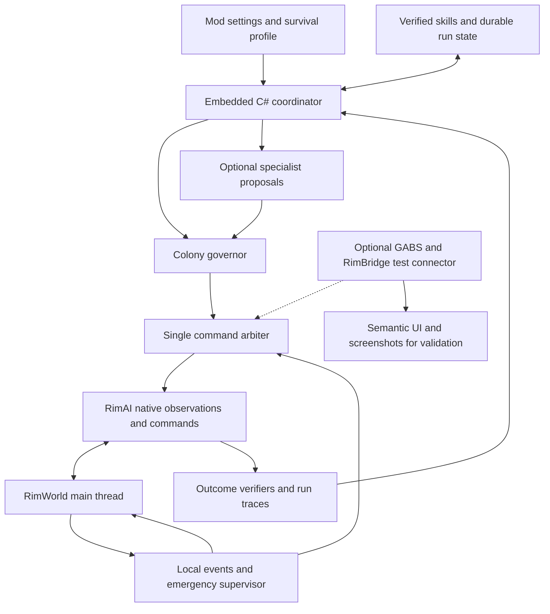

# Core design for an autonomous RimWorld player

**Recommendation:** ship an **embedded C# player runtime** in the RimAI Agent mod, using **RimAI Framework** for asynchronous provider access and a single native command arbiter. Reuse selected **AutoRim/RimMind** handlers, audited before adoption, and existing perception code. Use **GABS + RimBridgeServer** for optional development and live evaluation, and borrow **RLE** harness/scoring patterns. Normal play requires only the mod's standard dependencies and a supported provider key.

This is a research recommendation, not an implemented or runtime-validated design. Research was checked on September 9, 2026. Repository inspection used commit `30c053fb2` and the existing working tree. Beads `raf-2m2` tracks this report; `raf-ax7` tracks the proposed live integration evaluation. Existing M1 validation remains open under `raf-jo2`.

The initial objective is **reliable vanilla colony survival**. DLC and victory support are explicitly later phases, after survival is established. The concrete component and interaction design is in [Survival core architecture](../design/2026-09-09-survival-core-architecture.md). “As well as any human” remains the long-term ambition, not an initial acceptance claim.

## What already exists

The ecosystem now contains real game-control bridges, autonomous-player prototypes, and evaluation harnesses. These are materially more useful than dialogue-only mods. The following are reuse candidates, not claims of compatibility with the locally installed game.

| Project | Evidence and maturity | Recommended use |
|---|---|---|
| **[RimBridgeServer](https://github.com/pardeike/RimBridgeServer)** | MIT; RimWorld 1.6 bridge. Current generated documentation describes semantic selection, gizmos, designators, UI inspection, screenshots, time control, scripts, and companion extensions. Primarily a mod-testing/automation platform. | **Development/evaluation bridge.** Reuse native UI semantics, lifecycle checks, and SDK access to the player's internal contracts. It is not a complete colony policy and is not required for the shipped player. |
| **[GABS](https://github.com/pardeike/GABS)** | MIT; external game process supervisor and MCP bridge. Documents macOS Intel/Apple Silicon packages, Steam readiness, connection management, and attention handling. | **Optional test host and diagnostics.** Reuse process supervision and tool discovery instead of building a launcher. Players do not need to install it. Local compatibility still needs testing. |
| **[RIMAPI](https://github.com/IlyaChichkov/RIMAPI/tree/dfa4b2909e132081898845d0c4936fcefa86c91c)** | GPL-3.0; canonical repository is `IlyaChichkov/RIMAPI`, not the M4x28 fork. Pinned release v1.10.0 has extensive REST observations and game mutations, plus events. Inspected support covers 1.5–1.6. | Reuse as an independently versioned mod when useful, and study its state extraction and ordinary action handlers. Audit endpoint effects individually. Rich API coverage does not establish human-equivalent actions or full-game coverage. |
| **[RLE](https://github.com/AppSprout-dev/RLE/tree/9f53b07de55ecda8d42f954f1d149f96db77d83f)** | MIT. Current source supports interchangeable agent harnesses, MCP, a baseline, scenarios, traces, and a specialist-agent implementation. Its September 7 published comparison is 12 rows, one seed, ten decision ticks, N=1; N=4 is explicitly unpublished. | **Reuse evaluation and harness interfaces selectively.** Adapt a supported external-agent interface rather than hardwiring the original seven-agent arrangement. Audit commands and scoring before adopting its benchmark. |
| **[AutoRim](https://github.com/Critical-Reynolds/autorim-mcp/tree/89fadf37e5af4d4e5ca24e7b822d8b3fbb8084ca)** | C# mod plus TypeScript MCP server, with 24 tools grouping a larger command surface. Its actual LICENSE contains MIT text; GitHub metadata reports NOASSERTION. | **Preferred source donor for missing ordinary commands.** Movement uses a normal job. Audit each adopted handler: caravan departure has shortcut semantics. Its author reports limited tested mod coverage; no full survival benchmark was verified. |
| **[RimWorld Antfarm](https://github.com/Sorcerio/Rimworld-Antfarm)** | AGPL-3.0; explicitly presents an autonomous colony administrator with structured state, a REST bridge, and an LLM loop. | Study colony-level summaries, planning, and failure handling. Keep it a separate comparison candidate; do not silently incorporate differently licensed code into this MIT repository. |
| **[RimMind Actions](https://github.com/RimWorld-RimMind-Mod/RimWorld-RimMind-Mod-Actions)** | MIT action module in a larger pawn-focused mod suite. This repository already contains a source analysis. | Reuse selected native job/action patterns with attribution. Its pawn-decision focus, bool-style results, and object references do not supply a reliable external player protocol. |
| **[RimGym](https://github.com/jmduea/RimGym/tree/cf2658db2a681b5772a8b0858f260d96665cc959)** | MIT, RimWorld 1.6. Gymnasium/Protobuf environment with a narrow action vocabulary; explicitly no longer actively developed as of June 23, 2026. | Borrow reset/step and executive/reflex separation ideas. Do not make an unmaintained, incomplete control environment the core dependency. |
| **[RimAPI MCP Server](https://github.com/M4x28/RimAPI_MCP_Server/tree/cb800190761cfbcbbde14674648aae8cf04e967d)** | MIT wrapper over RIMAPI, February 2026 source. | Reference only. Another thin wrapper does not solve underlying action semantics or completion checks. |

The existing [research index](README.md) covers additional RimAI/RimMind provider, context, and memory patterns. Those remain useful; they do not replace a game-control bridge or a measured autonomous player.

### A critical distinction: commands versus shortcuts

RLE's current `move_colonist` implementation calls `/pawn/edit/position`. The corresponding canonical RIMAPI service implements teleportation by assigning pawn position and notifying the game of the teleport. This bypasses the normal movement job, travel time, and pathfinding. Thus a plausible command name does not establish a normal gameplay action. RLE also exposes direct repair/destruction and research override operations; each needs explicit classification before reuse. This establishes exposed capabilities, not that a particular published run used them. Source references are listed below under **Action semantics evidence**.

RimBridgeServer also exposes developer tools, and its documented default enables an ultrafast boost. Selecting that bridge does not solve fairness automatically. The player host must expose a reviewed gameplay capability set, disable the boost for the standard profile, and isolate debug capabilities in the evaluation fixture. See its [generated tools](https://github.com/pardeike/RimBridgeServer/blob/main/docs/tool-reference.md).

Normal play should issue a move job, place a blueprint, create a bill, set a work priority, choose research, or order treatment. The game should then determine travel, labor, resource use, injury, and success. Teleporting, directly completing construction/research, spawning resources, or reading hidden threats belongs to a separately labeled diagnostic mode.

### What other game agents contribute

| Project and license | Transferable design | Boundary on the evidence |
|---|---|---|
| **[Factorio Learning Environment](https://github.com/JackHopkins/factorio-learning-environment/tree/e2a829d22a63), MIT** | Structured observations/actions, task verifiers, execution traces, timing, reusable programs, and an environment interface. | Its [0.3 evaluation](https://jackhopkins.github.io/factorio-learning-environment/versions/0.3.0.html) includes constrained lab-play Pass@8 with unlimited thinking time. Neither its Docker setup nor Factorio server provides a RimWorld backend. |
| **[Voyager](https://github.com/MineDojo/Voyager/tree/55e45a880755), MIT** | A curriculum and retrievable executable skill library improved through execution feedback. | [Published results](https://arxiv.org/abs/2305.16291) concern Minecraft. Borrow the learning structure, replacing Minecraft programs and adding deterministic outcome checks. |
| **[Orak](https://github.com/krafton-ai/Orak/tree/c14e5a01f998), MIT** | Separate game servers, agent modules, clients, and controlled architecture comparisons. | Its [paper](https://arxiv.org/html/2506.03610v3) reports architecture-dependent gains and severe real-time latency limits. More planning or more agents can reduce performance. |
| **[Cradle](https://github.com/BAAI-Agents/Cradle/tree/d7752fccf890), MIT** | Screenshot interpretation, keyboard/mouse skills, memory, and UI recovery. | Its [paper](https://arxiv.org/html/2403.03186v3) uses pausing in important demonstrations. Use it as a fallback reference, not evidence that slow visual control handles continuous combat. |
| **[BALROG](https://github.com/balrog-ai/BALROG/tree/b7afe79e3e42), MIT** | Pluggable models/environments, long-horizon progress measurement, text/vision comparisons. | Its [paper](https://arxiv.org/abs/2411.13543) gives a useful evaluation method; historical scores do not set a current capability ceiling or establish RimWorld performance. |

These projects argue for tested skills, controlled simulation advancement, and comparative evaluation. They do not justify porting an entire Minecraft or Factorio stack, training an RL policy before a reliable environment exists, or assuming a multi-agent committee is inherently better.

## The architecture choice

| Approach | Strength | Main cost | Decision |
|---|---|---|---|
| Screenshots and mouse/keyboard as the primary interface | Broad UI and mod compatibility; actions resemble human interaction. | Fragile targeting, weak hidden-state diagnosis, latency, and difficult outcome verification. | Retain as fallback and comparison baseline. |
| Modular embedded C# runtime with pure planning and native adapters | Fits a normal install-and-key mod; reuses Framework and keeps control in-game. | Must isolate async work, settings, lifecycle and native dependencies carefully. | **Recommended production design.** |
| Native bridge plus an external agent host | Fast experimentation, interchangeable agents, existing MCP tools, and durable traces. | A separate runtime/service complicates installation and ongoing operation. | **Recommended development/evaluation design only.** |

The diagram describes modules, not separate processes. Start with one embedded governor and deterministic survival subsystems. Add specialist model calls only when they measurably improve results under the same budget.

### 1. Native adapter and optional test connection

The production Agent mod owns observations and normal commands, reusing this repository's snapshot/ID code after correcting omissions and adapting audited upstream handlers. Framework remains its declared provider dependency, alongside Harmony. Avoid duplicate Framework assemblies. GABS/RimBridgeServer supplies optional lifecycle/UI test tools; an SDK companion exposes the same production interfaces to evaluators.

The coordinator depends on a small interface: discover capabilities, observe, submit commands, obtain results/events, advance bounded simulation time, pause, and read run identity. Future audited external adapters use this same interface. All access shares the command arbiter; no optional bridge is an independent writer. Production runs must work with external connectors absent.

All accesses to live Verse/RimWorld objects happen on the Unity main thread. Network readers and LLM workers exchange plain DTOs. Pump pending requests on rendered updates even when the simulation is paused; separate that from tick-driven simulation work. A paused game must remain observable and controllable.

### 2. Complete queryable state and compact prompts

Retain complete accessible state in the bridge/world model; summarize only the portion sent to a model. Every observation needs schema/version information, save generation, map identity, game tick, freshness, completeness, and an explicit indication of omitted entities or unavailable fields.

The minimum world model covers pawns and needs; medical conditions; jobs and reservations; resources, bills, and production; buildings, power, fuel, temperature, and rooms; zones and policies; research prerequisites; threats and visible combatants; terrain, fertility, roofs, cover and traversability; and eventually caravans, factions, quests, and additional maps. Spatial planning needs actual coordinates and topology, not a terrain hash.

Return `unknown` when a subsystem cannot be observed. Zero fires, no infection, and no active raid are factual claims and cannot stand in for unimplemented extraction. Apply player-visibility filtering at the shared observation boundary before every production consumer, including deterministic skills and emergency supervision. Keep privileged instrumentation in a separate evaluator interface.

### 3. Commands and outcome verification

A command carries a unique ID, originating observation/tick, save generation, map, target IDs, typed parameters, preconditions, priority, deadline, and expected postconditions. Validate again on the main thread immediately before execution. Use explicit session ownership so only one controller owns writes; hand control back cleanly to a human. Optional external test access uses a lease through that same controller.

Separate `accepted`, `started`, and `completed` from `failed`, `cancelled`, and `expired`. Placing a blueprint completes the placement command; constructing the building completes a later skill objective. Ordering treatment does not prove that a pawn was treated. A disappeared target must be reconciled with the intended outcome, not automatically marked successful.

Use idempotency and query command status after an uncertain timeout before retrying. Reserve relevant pawns, cells, materials, and budgets to avoid conflicting specialist plans. On save/load, restart, or loss of ownership, invalidate queued commands and reobserve. Preserve high-level objectives and traces; do not replay old mutations blindly. This agrees with the reconciled plan's G-16 over the older research note about queue persistence.

### 4. Local emergency supervision

Emergency detection and pause control must not depend on an LLM returning in time. Use game events plus bounded polling as a backstop for raids, fire, dangerous temperature, medical deterioration, starvation risk, disconnects, and stalled actions. Begin with deterministic pause-and-reobserve behavior; add automatic rescue/retreat policies only after scenario testing.

Use event-driven interruption, operational skill checks, and slower strategic review. Choose tick windows experimentally and shorten them near danger. Ordinary play can pause while thinking. Report pause time and game time separately. Stop simulation advancement when the coordinator loses valid ownership, an optional external control lease expires, or inference budget is exhausted. A stopped run is not a survival success.

### 5. Governor, specialists, and skills

The governor maintains colony objectives, prerequisites, resource budgets, and competing risks. Invoke specialists for concrete decisions such as defense, medical care, spatial layout, or production. They return proposals; they do not directly command pawns. A single-agent baseline should remain available throughout development.

Skills are executable, bounded workflows: establish shelter, secure meals, stabilize a patient, sustain a production bill, defend a position, or prepare research infrastructure. Each records preconditions, permissible actions, resource requirements, interruption/cancellation behavior, progress checks, completion conditions, and compatibility constraints.

Use a rule-based or behavior-tree executor below the model for routine skill steps. Models select, parameterize, critique, and improve skills. Test generated candidates in isolated saved scenarios before promoting them to the live library. Arbitrary model-generated C# or unrestricted debug scripts should not execute in a scored colony.

### 6. Embedded runtime, memory, and model choice

A pure C# decision layer separates goals, skills, arbitration, and outcome predicates from Verse and provider transport. The in-game coordinator drives it while async workers call the provider with immutable configuration. Optional Python evaluators can reuse RLE/FLE tooling; a test connector can expose the same contract through MCP to Codex and other agents. None is a player installation requirement.

Begin with versioned domain state in RimWorld saves and bounded local event/command logs. Avoid a required database or embedding service. Separate objectives, episodic outcomes, verified skills, and sourced game knowledge. Retrieve relevant failures and lessons; do not inject the entire history. Invalidate observations across save generations and record game/mod versions on skills.

Keep model/provider selection behind an injected gateway inside the mod. Compare a small supported provider/model matrix on the same scenarios and budgets. Route routine decisions to deterministic logic first; reserve model reasoning for consequential planning. Track requests, reported tokens, cost when available, latency, game ticks advanced, and interruptions. Embeddings are optional. Connection setup must test the actual structured response contract.

## What this repository can contribute

Current code is a partial perception implementation plus scaffolding, not a working player. The July live snapshot result is **REPORTED** in Beads; it was not reproduced during this research.

| Current finding | Evidence in this checkout | Design consequence |
|---|---|---|
| Provider plumbing supports completion, streaming, tools, embeddings and token-usage data. Public calls select the globally active chat provider. | `RimAI.Framework/Source/API/RimAIApi.cs:97`; `RimAI.Framework.Contracts/Models/UnifiedChatModels.cs:10,73` | Reuse as the provider foundation; add immutable per-request configuration and remove background-path settings reads. |
| Snapshot builder, diffing, trimming, event bus, IDs and debug commands exist. | `RimAI.Agent/Source/Perception/SnapshotBuilder.cs:31`; `SnapshotDiffEngine.cs:24` | Preserve useful extraction and contracts; compare against bridge capabilities before duplicating them. |
| Snapshot caps include 8 colonists, 5 hostiles and 20 buildings; important map/threat/medical fields are placeholders. | `SnapshotBuilder.cs:21,234,357,446` | Replace silent omission with queryable full state and explicit completeness/unknown fields. |
| Action queue/verifier and cognition entry points throw `NotImplementedException`; memory/UI are largely definitions. | `RimAI.Agent/Source/Action/ActionContracts.cs:55,225`; `Cognition/ICognitionEngine.cs:85`; `UI/AdminTab.cs:7` | There is no completed control loop to preserve. Implement the bridge outcome contract before autonomous planning. |
| Hook bodies and attributes exist, but no activation call was found under Agent source; the file calls them compile-only. | `RimAI.Agent/Source/Perception/Events/PerceptionHarmonyHooks.cs:13`; `AgentGameComponent.cs:14` | A clean load does not verify subscriptions. Exercise every event hook in-game. |
| Cadence constants differ from the corrected plan and are not wired into the loop. | `CadenceController.cs:28`; `docs/plan/06-plan-audit.md:89,117` | Reconcile after measuring the new host; do not inherit either schedule unquestioningly. |
| Command DTO lacks observation/save identity; verifier comments allow false-positive success. | `Action/ActionCommand.cs:12`; `Action/ActionContracts.cs:178` | Strengthen stale-state handling and outcome verification before reuse. |

The existing layered separation and main-thread boundary remain sound. The selected product architecture keeps a modular runtime inside RimWorld and adds an optional established test connection. The master plan now explicitly points to this product decision. Detailed layer specifications still need reconciliation for installation, provider configuration, ownership, outcome verification, and survival-only scope before implementation.

## Proving progress toward human-level play

Freeze the game build, DLC/mod list, scenario, storyteller, difficulty, seed/save, model, harness, command profile, pause/reload rules, budgets, and scoring version for every run. Preserve before/after state, action results, selected screenshots, and failure traces. A “decision tick” in a benchmark must not be confused with one RimWorld simulation tick.

| Validation stage | Required evidence |
|---|---|
| **Bridge reliability** | A scripted agent observes, issues an ordinary command, advances time, and verifies its result in the real game. Include paused operation, failed targets, timeouts, reconnect, save/load invalidation, and emergency pause. |
| **Basic capability** | Food, shelter, temperature, work priorities, bills, construction, research, movement, rescue and treatment each pass saved-scenario success and failure cases. Verify that resources and pawn work are actually consumed. |
| **Survival** | Unattended progression across multiple seeds for 5 days, then 30 days, then a winter/year. Report deaths, starvation, treatment outcomes, reserves, human interventions, reloads, and stuck loops. |
| **Later: victory and DLC** | After survival meets its acceptance gate, separately add victory chains, trade/caravans where needed, quests, and DLC-specific mechanics. None is required to declare the initial survival implementation finished. |
| **Later: human comparison** | Compare with human runs under matched information, starting state, pause/reload rules and objectives, including held-out biomes, difficulties and incident combinations. Publish distributions and uncertainty rather than a best run. |

An initial development gate can require at least five distinct seeds before moving beyond a survival milestone; this is a proposed engineering threshold, not statistical proof. Expert-level claims require a larger held-out suite and matched human data. Keep speed, success probability, colony quality, cost, and intervention rate separate; a single composite can conceal a fatal weakness. Avoid rewarding raw wealth growth when it can increase colony risk.

Run ablations for governor alone versus specialists, skills on/off, memory on/off, and structured observations versus structured plus vision. Include an unmanaged-colony baseline and a scripted policy baseline. Use mock states for protocol tests; reserve gameplay claims for the actual game. Record fixture assistance such as prebuilt facilities and report recovery/reload experiments separately from uninterrupted runs.

## Recommended first implementation boundary

The next task is the **embedded control/runtime evaluation (`raf-ax7`)**, not a full autonomous playthrough. Prove the in-mod observation/action/provider lifecycle and installable dependency arrangement first. Pin GABS/RimBridgeServer as optional test aids, reuse their tools for validation, and adapt upstream ordinary handlers where useful. Compare RIMAPI observations and handlers without adding a production dependency or independent writer.

The first concrete success should be a scripted sequence that obtains state, places a valid blueprint, creates a production bill, assigns work, selects valid research, moves a drafted pawn through a normal job, and verifies rescue/treatment after advancing the game. Deliberately test impossible and stale requests. That provides a trustworthy environment on which a governor can learn and improve.

No game launch, mod install, dependency installation, compilation, gameplay mutation, or full-run benchmark occurred for this report. Both mod projects have post-build targets that replace deployed mod directories; future builds must use an explicitly checked deployment target. Existing pure-source tests cannot establish native game integration.

## Source and reuse notes

Current repository source and primary upstream code/docs were inspected; externally reported gameplay outcomes were not reproduced. License labels identify the inspected files, not blanket permission to relicense dependencies. Preserve copyright/license notices, record modified files, and keep each reused component's provenance. No third-party code was imported during this research.

Important pinned primary sources:

- [RIMAPI v1.10.0 source](https://github.com/IlyaChichkov/RIMAPI/tree/dfa4b2909e132081898845d0c4936fcefa86c91c), June 21, 2026; [GPL-3.0 license](https://github.com/IlyaChichkov/RIMAPI/blob/dfa4b2909e132081898845d0c4936fcefa86c91c/LICENSE).
- [RLE current README](https://github.com/AppSprout-dev/RLE/blob/9f53b07de55ecda8d42f954f1d149f96db77d83f/README.md), September 9, 2026; use this over older search snippets describing only seven agents and an earlier leaderboard. Its README also warns that Workshop RIMAPI may lack the fork endpoints used by its runs; capture the actual DLL hash and fork commit.
- [AutoRim license](https://github.com/Critical-Reynolds/autorim-mcp/blob/89fadf37e5af4d4e5ca24e7b822d8b3fbb8084ca/LICENSE), inspected directly rather than relying on GitHub license classification.
- [RimBridge architecture](https://github.com/pardeike/RimBridgeServer/blob/main/docs/architecture.md), [semantic state](https://github.com/pardeike/RimBridgeServer/blob/main/docs/semantic-state-design.md), and [tool reference](https://github.com/pardeike/RimBridgeServer/blob/main/docs/tool-reference.md), accessed September 9, 2026. Architecture documents contain both implemented and proposed material; generated tool documentation is stronger evidence of exposed capabilities than a roadmap.
- [GABS README](https://github.com/pardeike/GABS/blob/main/README.md), accessed September 9, 2026; documents host packages, game process management, Steam readiness and MCP discovery.

### Action semantics evidence

- [RLE movement helper](https://github.com/AppSprout-dev/RLE/blob/9f53b07de55ecda8d42f954f1d149f96db77d83f/src/rle/rimapi/client.py#L1234) and [RIMAPI teleport implementation](https://github.com/IlyaChichkov/RIMAPI/blob/dfa4b2909e132081898845d0c4936fcefa86c91c/Source/RIMAPI/RimworldRestApi/Services/Pawns/PawnEditService/PawnEditService.cs#L312).
- [RLE action dispatch](https://github.com/AppSprout-dev/RLE/blob/9f53b07de55ecda8d42f954f1d149f96db77d83f/src/rle/orchestration/action_executor.py#L359) and [RIMAPI research override](https://github.com/IlyaChichkov/RIMAPI/blob/dfa4b2909e132081898845d0c4936fcefa86c91c/Source/RIMAPI/RimworldRestApi/Helpers/ResearchHelper.cs#L121).
- [AutoRim ordinary movement/jobs](https://github.com/Critical-Reynolds/autorim-mcp/blob/89fadf37e5af4d4e5ca24e7b822d8b3fbb8084ca/mod-src/AutoRim/Commands/JobCommands.cs#L76) and [caravan shortcut](https://github.com/Critical-Reynolds/autorim-mcp/blob/89fadf37e5af4d4e5ca24e7b822d8b3fbb8084ca/mod-src/AutoRim/Commands/CaravanCommands.cs#L162).
- [RIMAPI trade controller](https://github.com/IlyaChichkov/RIMAPI/blob/dfa4b2909e132081898845d0c4936fcefa86c91c/Source/RIMAPI/RimworldRestApi/Controllers/Colony/TradeController.cs) and [world controller](https://github.com/IlyaChichkov/RIMAPI/blob/dfa4b2909e132081898845d0c4936fcefa86c91c/Source/RIMAPI/RimworldRestApi/Controllers/World/GlobalMapController.cs): inspected upstream exposes relevant reads, not complete transaction/caravan-formation workflows.
- [RimBridgeServer v2.1.1 tools at `ca5997c9`](https://github.com/pardeike/RimBridgeServer/blob/ca5997c9e02f53609358223a673834e35a1d1ee1/docs/tool-reference.md), [companion SDK](https://github.com/pardeike/RimBridgeServer/blob/ca5997c9e02f53609358223a673834e35a1d1ee1/Source/RimBridgeServer.Sdk/README.md), and [GABS v1.1.1 source at `b5f441a0`](https://github.com/pardeike/GABS/tree/b5f441a04fa908852fdece18a08a8876ac970a4d), August 24, 2026.
